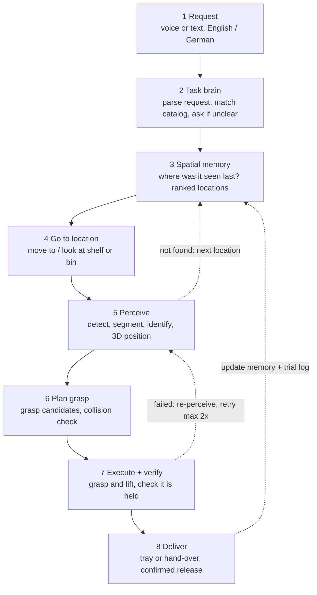

# Dynamic Storage Picking

Robotics & AI Hackathon 2026 · Challenge 3

End-to-end plan: dataset → model → robot → demo → pitch

Siemens Healthineers Innovation Center Erlangen · 22–24 Oct 2026 (confirm final day)

Prepared 9 Oct 2026 for Rohith's team · process plan, no code

> Numbers marked as targets are team goals, not standards. Sources are listed at the end.

---

## The plan on one page

> **Goal**
>
> A worker asks for an item by voice. The robot works out where the item probably is, finds it even though the storage has been rearranged, grasps it and hands it over. You prove it works with measured numbers and a live demo the jury can disrupt.

### What wins first prize

1. **A reliable core pick.** Target at least 80% end-to-end success over 20+ logged trials on reshuffled layouts. A robot that works on stage beats a cleverer robot that fails.
2. **Spatial memory.** The robot remembers where it last saw each item and searches the most likely places first. This is what "dynamic storage" really asks for, and most teams will skip it.
3. **Natural requests.** Voice in German and English, with a clarifying question when a request is ambiguous.
4. **New items in seconds.** Enroll a new item with a few photos, without retraining.
5. **Proof.** A trial log, a measured human baseline, and a live demo where a jury member reshuffles the shelf.

### Six workstreams

| # | Workstream | Output | Owner |
|---|---|---|---|
| 1 | Data | Labelled dataset v1 → v3, golden test set, identification gallery | Perception lead |
| 2 | Perception models | Detector + segmenter, item identification, 3D localization | Perception lead |
| 3 | Grasp + motion | Calibrated robot, grasp planner, pick-and-deliver skill | Manipulation lead |
| 4 | Task brain | Voice, request parser, spatial memory, search strategy, dashboard | Rohith |
| 5 | Integration + testing | State machine, logging, trial protocol, safety | Integration lead |
| 6 | Pitch | Story, measured numbers, demo script, backup video | Shared / pitch lead |

### Timeline

| Phase | Focus | Day file |
|---|---|---|
| Prep · 9–21 Oct | Team, questions, environment, practice data loop | Section 4 below |
| Day 1 | Calibrate, first data, walking skeleton | [day1/day1.md](day1/day1.md) |
| Day 2 | First full voice-to-handover run | [day2/day2.md](day2/day2.md) |
| Day 3 | Dynamic layouts, memory, reliability, feature freeze | [day3/day3.md](day3/day3.md) |
| Final day (Day 4) | Reliability runs, rehearsal, pitch | [day4/day4.md](day4/day4.md) |

**Event facts.** Innovation Center Erlangen, Henkestr. 127. The event page lists 22 Oct 09:00 to 24 Oct 19:00 and describes 4 days, 5 challenges and about 200 hackers [1]; the FAU Innovation Days page lists 22–25 Oct [2]. This plan uses Day 1 to Final day. If the event turns out to be 3 days, merge Day 3 and the Final day as marked in Section 8.

---

## 1. Confirm these before you build anything

Send these to the organizers now. Each answer removes a branch from this plan.

| # | Ask | Why it matters |
|---|---|---|
| 1 | Which robot exactly? Arm model, gripper or hand, mobile base, humanoid? | Decides the grasp method, motion planning stack and how much you can scope. |
| 2 | Which cameras, mounted where? Is there depth (RGB-D)? | 3D localization needs depth. The mount decides the calibration type. |
| 3 | Which items, how many? Can we see or photograph them before the event? | Lets you build and test the dataset pipeline in advance. |
| 4 | What does "dynamic" mean here? Items moved between bins, bins moved, new items added? | Decides the memory and search design. |
| 5 | How is it judged? Rubric, weights, demo format, minutes per team? | You optimize for what is scored. |
| 6 | Is robot time shared? Are there booking slots? | Hardware time is usually the bottleneck. Plan offline work around it. |
| 7 | On-site GPU? Internet? Any API restrictions? | Decides local vs cloud models. |
| 8 | Is pre-written code allowed? Which open-source models and APIs are allowed? | Decides what you prepare now versus what you build on site. |
| 9 | Prizes per challenge or overall? Can Siemens Healthineers employees win prizes? | Strategy, and your own eligibility. |
| 10 | Simulation assets? Robot URDF/USD, storage dimensions or CAD? | Lets you rehearse the pick sequence before Day 1. |

Hackathon contacts named on the event page: Sebastian Schroth and Nicolas Butterwegge.

---

## 2. Team and roles

| Role | Owns | Day 1 deliverable |
|---|---|---|
| Perception lead | Dataset, detector, item identification, 3D localization | Zero-shot baseline and first data capture from robot views |
| Manipulation lead | Robot bring-up, calibration, grasping, motion planning | Calibrated robot that touches a detected point within a few mm |
| Integration lead | State machine, interfaces, logging, navigation if mobile | Interface contract and a skeleton that runs end to end with dummy data |
| Task brain + UX (Rohith) | Voice, request parsing, spatial memory, search strategy, dashboard | Item catalog with synonyms, memory schema, parser working on typed text |
| Pitch + product (shared) | Problem numbers, human baseline, slides, demo script, video | Storyboard and trial log template |

- With 3 people: merge Integration into Manipulation, and Pitch into Task brain.
- One owner per interface. Three stand-ups a day (09:00, 14:00, 20:00), 10 minutes each.
- Sleep rota. Whoever drives the robot during a demo must be rested.

---

## 3. System architecture

A modular pipeline. Every block can be tested alone, swapped, and debugged in hours. Steps 1 to 4 decide, steps 5 to 8 act, and memory closes the loop.

**Dashboard + trial log:** live camera view · memory map with "last seen" times · task status · stage timings · success rate

> **Why not one end-to-end robot model?**
>
> - End-to-end vision-language-action policies need demonstrations per task. A common starting point for one task is about 50 high-quality episodes, plus hours of GPU training [5]. Layouts that keep changing are exactly where such a policy struggles.
> - Spend learning where it pays: perception and item identification. Keep motion analytic and predictable.

### Design rules

- **Tag the furniture, not the items.** AprilTags on shelves and bins make locations easy to find. Items stay untagged, so the dynamic problem stays real.
- **The language model never drives motors.** It only chooses from fixed skills (find, pick, deliver, scan, cancel) with checked parameters. Speed and workspace limits sit below it.
- **Log everything.** Every trial, failure stage and timing. These numbers become your pitch.
- **Walking skeleton first.** Connect all eight steps crudely on Day 1, then improve the weakest link.

---

## 4. Before the hackathon (9–21 Oct)

> **Do this weekend**
>
> - Register (admission is rolling) and send the Section 1 questions.
> - Lock in your team and roles.
> - Request access to gated model weights now. SAM 3 weights need approval on Hugging Face [3].

### Week 1 · 9–15 Oct

- [ ] Read the rules on pre-written code. If it is not allowed, prepare environments, notes and practice only.
- [ ] Set up one or two Linux laptops with an NVIDIA GPU: ROS 2 (match the robot vendor's version), a Python ML environment, and Docker images built and tested offline. Download every model weight locally.
- [ ] Practice the full data loop at home with 6 household tools: film, extract frames, auto-label, review, train, test live on a webcam. Time every step. This gives you your real turnaround on site.
- [ ] Write the item request format, the catalog template (names, English and German synonyms, attributes) and the memory schema.

### Week 2 · 16–21 Oct

- [ ] Rehearse hand-eye calibration and MoveIt 2 planning with collision objects. Add Nav2 waypoints if a mobile base is likely.
- [ ] If the robot model is known: build a simple simulation of shelf, bins and robot (Isaac Sim, Gazebo or MuJoCo) and rehearse the pick sequence.
- [ ] Task brain: speech-to-text, request parsing, clarification rules, dashboard layout. Reuse the voice-agent patterns you already know.
- [ ] Pitch: storyboard, problem slide with sources, demo script draft, trial log template.
- [ ] Print and pack: a rigid matte ChArUco calibration board, AprilTag sheets in 2–3 sizes, plus the Section 13 packing list.

---

## 5. Dataset: from zero to v3

### 5.1 Define the item catalog (Day 1, first hour)

- Use the organizers' items. Typically 6–10. Mix easy shapes (boxes, bottles) and hard ones (thin handles).
- Include 1–2 look-alike pairs if they exist, such as two wrench sizes. They showcase fine-grained identification and the clarifying question.
- Per item, record: name, synonyms (EN/DE), size, colour, weight, grasp type (pinch, suction, top-down) and possible storage locations.
- Healthcare angle for the story: service tools (torque wrench, multimeter, cables) and clinical consumables (glove box, gel bottle, syringe pack).

### 5.2 Four data sources, in order of value

| Source | What you do | When | Why |
|---|---|---|---|
| 1 Zero-shot baseline | Run open-vocabulary detection with just the item names: YOLOE-26 text prompts and SAM 3 concept prompts [3][4]. | Day 1, first 2 hours | Shows which items already work and which need training. |
| 2 Real robot-camera images | Capture with the exact camera, resolution and viewpoints the robot will use, across many layouts. | Days 1–3 | Train on what the robot will actually see. Your biggest accuracy lever. |
| 3 Auto-label + human review | SAM 3 text or box prompts produce masks. A person fixes them in CVAT, Label Studio or Roboflow. | After every capture | Far faster than drawing masks by hand; review keeps quality high. |
| 4 Augment + synthetic | Standard augmentations. Copy-paste masked items onto empty-shelf images. Optional: Isaac Sim Replicator with phone-scanned meshes [9]. | Days 2–3, only for gaps | Covers rare cases such as heavy clutter and odd angles. |

### 5.3 Capture protocol

| Session | Setup | Images | Purpose |
|---|---|---|---|
| S1 Clean | Each item alone in each bin type; 3 lighting conditions | 80–120 | Base appearance |
| S2 Shuffled | 5+ random layouts with all items present | 120–200 | Layout variety |
| S3 Clutter | Items touching, partly hidden, stacked; non-catalog distractors | 100–150 | Robustness |
| S4 Robot views | From the robot's real scan poses (and while moving, if mobile) | 100–150 | Matches deployment |
| S5 Hard negatives | Look-alikes side by side, empty bins, unknown objects | 50–100 | Fewer wrong picks |

- Record short videos and keep 2–3 frames per second to avoid near-duplicates.
- Plan for at least ~150 labelled instances per item in v1. These counts are planning targets, not rules.
- Lock camera exposure and resolution. Capture and deployment settings must match.

### 5.4 Labelling rules

- Label an item when roughly a third or more of it is visible. Box and mask the whole object, including handles.
- One class per catalog item. Look-alikes get separate classes.
- Treat non-catalog objects consistently: either always unlabelled or always one "other" class.
- A second person reviews 10% of labels. Fix systematic errors before training.

### 5.5 Splits, versions and the golden test set

- Split by session or layout, never by random frames. Neighbouring frames leak and inflate scores.
- **Golden test set:** 1–2 layouts that are never used for training. Score every model version on them.
- **Identification gallery:** 5–10 clean reference crops per item, from several angles.
- **Versions:** v1 at the end of Day 1 (S1–S2), v2 at the end of Day 2 (+S3–S4), v3 on Day 3 (failure cases only). Keep a one-page dataset card: classes, counts per class, sessions, known gaps.

---

## 6. Models: what to use, train and measure

### 6.1 Perception stack

| Stage | Recommended | Fallback / upgrade | Notes |
|---|---|---|---|
| A Detect + segment | Fine-tuned YOLO26 segmentation model on your catalog (n, s or m size) [4] | YOLOE-26 open-vocabulary for any new item by text prompt [4] | Fast enough for the live loop. AGPL-3.0 licence: fine for a hackathon, check before product use [4]. |
| B Identify the exact item | Embedding gallery: crop, compute an image embedding (DINOv2/v3 or CLIP), match to the nearest reference | Small classifier trained on crops | Enroll a new item with 5–10 photos, no retraining. Ask the user when similarity is low. |
| C Locate in 3D | Mask + aligned depth gives an object point cloud. Remove outliers, compute centre and main axis. | Fuse several frames; add a second viewpoint | Convert to robot coordinates with the hand-eye calibration. |
| D Reason (optional) | A vision-language model for vague requests, pointing and success checks, e.g. Gemini Robotics-ER 1.5 via API [6] | Local VLM if there is no internet | Keep it off the critical path: network and latency. |

SAM 3 is strong but heavy (about a 3.45 GB checkpoint) [3]. Use it for labelling, not in the live loop.

### 6.2 Training loop (every version)

1. Train from pretrained weights on the current dataset version. Use image size 640–1024; larger helps small items.
2. Score on the golden test set: mAP, recall per item, and confusion between look-alikes.
3. Build a failure gallery. Look at every miss and every false detection.
4. Capture targeted data for the top failure causes. Not just "more data".
5. Retrain, re-score, keep the better model. Never deploy a model you have not scored.

Start training runs before breaks and overnight. Keep working with the previous version meanwhile.

### 6.3 Grasping in three tiers

| Tier | Method | Use when | Effort |
|---|---|---|---|
| 1 Default | Analytic grasp: approach top-down over the object centre. A parallel gripper closes across the short axis; suction targets the flattest area near the centre. Add a pre-grasp offset and a slow approach. | Items lie in open bins or trays | Low. Works by Day 2. |
| 2 Upgrade | Learned 6-DoF grasp generator, e.g. NVIDIA GraspGen. Out of the box it supports the Franka Panda gripper, the Robotiq 2F-140 and a suction cup (30 mm radius); check the licence [7]. | Clutter, awkward shapes | Medium. Needs a GPU and clean point clouds. |
| 3 Only if time | Imitation learning for one hard sub-skill (e.g. opening a drawer) with LeRobot ACT or SmolVLA: about 50 good demos and hours of training [5]. | Teleoperation is available and the motion repeats | High. Risky in 3.5 days. |

### 6.4 Targets

| Metric | Target | How you measure it |
|---|---|---|
| Detection mAP50 on the golden set | ≥ 0.85 | Model evaluation |
| Recall per item | ≥ 0.90 | Model evaluation |
| Identification accuracy, including look-alikes | ≥ 95% | Gallery test on held-out crops |
| 3D position error | ≤ 1 cm | Touch test against a tape measure |
| Grasp success per item | ≥ 85% over 10 tries | Trial log |
| End-to-end success on reshuffled layouts | ≥ 80% over 20+ trials | Trial log |
| Time from request to delivery | Median ≤ 90 s (robot-dependent) | Trial log |

These are team targets, not industry standards. Adjust them on Day 1 once you know the robot.

---

## 7. Robot integration

### 7.1 Bring-up and calibration (Day 1)

1. Robot driver running. Move to named poses, open and close the gripper, test the e-stop.
2. Camera: check depth-to-colour alignment and resolution; lock exposure.
3. Hand-eye calibration with the ChArUco board, 15–25 varied poses.
4. Touch test: command the gripper tip to a detected point and measure the error. Aim for under ~5 mm.
5. Tape-mark the camera and robot mounts. Repeat the touch test before every demo.
6. Measure shelves and bins, put AprilTags on each, and add them as collision boxes in the motion planner.

### 7.2 The pick-and-deliver skill

Run it as a state machine or behaviour tree. Every step gets a timeout and a clear failure message that the dashboard shows and the voice says.

1. Receive the request: item, attributes, quantity, destination.
2. Ask memory for ranked candidate locations.
3. Move to the observation pose for the top location.
4. Capture RGB-D and fuse 3–5 frames.
5. Detect, segment, identify. Not found: try the next location. Nowhere: full scan, update memory, tell the user.
6. Compute the 3D pose and grasp candidates. Choose the best collision-free one.
7. Pre-grasp, approach, grasp, lift.
8. Verify with gripper width or force (or the vacuum sensor), plus a camera check that the item left the bin.
9. If it failed: re-perceive and retry up to 2 times with the next candidate, then ask for help.
10. Move to the delivery pose. Place in a tray, or hand over and release only when the person pulls or confirms.
11. Update memory and log the trial with timings per stage.

### 7.3 Hardware branches

| If you get… | Do this | Scope advice |
|---|---|---|
| Fixed arm + parallel gripper | Tier-1 grasps. A wrist camera for close views, plus an overview camera if available. | Items that lie flat; avoid very small or thin items. |
| Fixed arm + suction | Target flat surfaces; use the vacuum sensor for verification. | Boxes, bottles, packaged consumables. |
| Mobile manipulator | Nav2 waypoints in front of each shelf, then the fixed-arm pipeline. Re-localize using the shelf tags. | Keep routes short and fixed. |
| Humanoid | Fixed stance, or walk only between fixed waypoints. Use the vendor's arm IK and the simplest hand closure. | Fewer, chunkier items. Slow and safe. |
| Simulation only | Same pipeline in an Isaac Sim scene; real camera perception shown on a real shelf alongside. | Sell the path from sim to real. |

### 7.4 Spatial memory

- Per item, store: location (shelf, bin), 3D position, time last seen, confidence, and how it was seen (scan, pick, delivery).
- Update on every observation, even while looking for something else.
- Search order: last-seen location first, then other locations ranked by recency, category priors (e.g. consumables usually in drawer A) and travel distance.
- Not found anywhere: run a full scan, say so honestly, and offer the closest alternative.
- Show it on the dashboard as a live shelf map with ages ("seen 2 min ago"). The jury watches the robot think.

> **Your edge**
>
> This is a small knowledge graph: item → bin → shelf → zone, with time stamps and confidence. Your GraphRAG experience maps straight onto it, including querying by name, synonym or attribute. Most robotics teams will not build this layer.

### 7.5 Task brain and voice

- Local speech-to-text (e.g. Whisper), then a language model turns the sentence into a structured request: item, attributes, quantity, destination.
- Match to the catalog using synonyms and embeddings, in English and German.
- Ambiguous? Ask one short question: "Two torque wrenches here, 10 or 20 Nm?" Unknown item? Say so and offer to enroll it.
- Speak short status updates: "Not in bin B2 any more. Checking B4."

### 7.6 Safety

- An e-stop within an operator's reach at all times. Reduced speeds. Workspace limits set in the controller.
- Nobody inside the arm's reach during motion. Hand over via a tray, or slowly with confirmed release.
- One team member is the dedicated safety operator in every demo.

---

## 8. Hackathon day by day

Each day also has its own working file: [Day 1](day1/day1.md) · [Day 2](day2/day2.md) · [Day 3](day3/day3.md) · [Day 4 / Final day](day4/day4.md)

### Day 1 · Understand and build a walking skeleton

| Time | Who | What |
|---|---|---|
| 09:00–11:00 | All | Kick-off and briefing. Inspect robot, storage and items; photograph everything. Ask the open Section 1 questions and get the judging rubric. |
| 11:00–12:00 | All | Freeze architecture, interfaces and owners. Set up the trial log and dataset card. |
| 12:00–15:00 | Perception | Zero-shot baseline; capture S1–S2 from robot views. |
| | Manipulation | Bring-up, e-stop test, hand-eye calibration, touch test. |
| | Task brain | Catalog and synonyms, memory schema, parser working on typed text. |
| | Integration | Skeleton connecting all modules with dummy data. |
| 15:00–20:00 | Perception | Auto-label and review v1; start training. |
| | Manipulation | Pick one item from a hard-coded position and place it in the tray. |
| Night | Perception | v1 training runs; score it first thing in the morning. |

> **Day 1 checkpoint**
>
> The camera detects an item and the robot moves its gripper to touch it. That proves the whole chain from pixels to robot coordinates.

### Day 2 · First full voice-to-handover run

| When | Who | What |
|---|---|---|
| Morning | Manipulation | Tier-1 grasps on 3 items from bins; place in tray. |
| | Perception | Score v1 on the golden set; capture S3 (clutter) and S4 (robot views). |
| | Task brain | Voice → parser → skill call. Memory updated from scan results. |
| | Integration | State machine chains perceive → grasp → deliver, with timeouts and retries. |
| Afternoon | Perception | Label and train v2; check 3D accuracy with the touch test. |
| | All | First voice-to-handover run. Start the trial log (10+ trials). |
| Evening | Task brain | Dashboard v1: camera view, memory map, task status. |
| | All | Review the trial log. Choose Day 3 scope (Must and Should only). |

> **Day 2 checkpoint**
>
> One complete run from a spoken request to a handover.

### Day 3 · Dynamic layouts and reliability

| When | Who | What |
|---|---|---|
| Morning | Manipulation + Perception | All catalog items. Reshuffled-layout runs. Fix the top failure causes. |
| | Task brain | Memory-guided search and recovery lines, clarifying questions, enroll-new-item flow. |
| Afternoon | All | 30+ logged trials. Collect v3 data only for observed failures. |
| | Pitch | Measure the human baseline. Record backup video of the best runs. Draft slides. |
| Evening | All | Feature freeze. From here on: only reliability fixes. |

> **Day 3 checkpoint**
>
> At least 80% success over the last 20 trials on reshuffled layouts, or a clear plan to reach it by scoping down the item set.

### Final day · Reliability, rehearsal, pitch

| When | Who | What |
|---|---|---|
| Morning | All | Reliability runs only. Tune speeds. Compute the final metrics from the trial log. |
| | Pitch | Put the real numbers into the slides; cut the backup video. |
| Midday | All | Rehearse the pitch 3 times with a timer. Rehearse the live reshuffle with an outsider playing the jury. |
| Before pitch | Safety operator | Run the pre-demo checklist (Section 13). |

**If the event is only 3 days:** freeze features at lunch on Day 3 and use that afternoon as the final day.

---

## 9. Testing and proof

### 9.1 Trial log (one row per attempt)

Trial ID · time · layout ID · requested item and exact phrasing · success or failure · failure stage (understanding, search, detection, identification, localization, grasp, transport, handover) · time per stage · total time · notes · video file.

### 9.2 Protocol

- After every change, run at least 5 trials on a freshly reshuffled layout.
- Report only numbers from logged trials. Use the golden layout for the final numbers.

### 9.3 Failure guide

| Symptom | Likely cause | Fix |
|---|---|---|
| Item missed from one view | That viewpoint is missing from the data | Capture that view and retrain; add a second observation pose. |
| Wrong item picked | Look-alikes, weak identification | More reference crops; ask when confidence is low. |
| Holes in depth on shiny or black items | Depth sensor limits | Fuse frames; change the view angle; grasp the visible part. |
| Gripper misses by about 1 cm | Calibration drift | Touch test; recalibrate; check the tape marks. |
| Item slips | Grasp point or force | Grasp nearer the centre of mass; lift slower; suction for flat items. |
| Planner fails or collides | Planning scene incomplete | Pad shelf boxes; add bin walls. |
| Long delays | Heavy models in the loop | Smaller model size; call the VLM only as a fallback. |

### 9.4 Human baseline

Time a person (ideally not from your team) fetching the same items from the same reshuffled storage: once knowing the layout, once not. Put that comparison in the pitch. For context: in a survey by software vendor Infor, 32% of nurses said they spend more than 20 minutes per shift searching for supplies [8]. In an Irish hospital study, reorganizing a treatment room cut the time to gather IV cannulation equipment from 118 to 29 seconds [10].

---

## 10. Demo and pitch

Likely judging dimensions (confirm the real rubric): working prototype, innovation, value for Siemens Healthineers and its customers, technical depth, presentation.

### 10.1 Live demo script (about 4 minutes)

1. 20 seconds on the problem, with one number.
2. A jury member reshuffles the storage.
3. Spoken request in German, then one in English.
4. The robot checks memory, finds the item is not where it was last seen, says so, searches the next likely spot, then finds, grasps and delivers it.
5. An ambiguous request. The robot asks a clarifying question.
6. Enroll a new item with a few photos. The robot fetches it.
7. The dashboard: memory map and trial statistics.

### 10.2 Pitch structure (5–7 minutes)

1. Problem and cost: the external number plus your measured human baseline.
2. Solution in one sentence.
3. Live demo.
4. Measured results: success rate, median time, number of trials, comparison with the human baseline.
5. Why it scales: modular, new items without retraining, works with any robot that has a camera and a gripper.
6. Where Siemens Healthineers could use it: service tool storage, manufacturing, hospital supply rooms.
7. Next steps: a concrete pilot proposal. Then the team.

### 10.3 Backups

- A recorded video of the best full run, ready to play.
- Metric slides saved as images.
- A laptop demo of perception, memory and voice if the robot fails.

---

## 11. Scope control and decision rules

| Priority | Items |
|---|---|
| Must | Request → find → pick → deliver for 5+ items in reshuffled bins. ≥ 80% success over 20+ logged trials. Safety. Trial log. |
| Should | Memory-guided search. Clarifying questions. Dashboard. Enroll a new item. |
| Could | German voice. VLM verification. Driving between shelves. Learned grasping. Multi-item orders. |
| Won't (this event) | End-to-end VLA policy. Transparent items. Deformable items (unless required). |

> **Decision rules**
>
> - Grasp success on an item below 60% by Day 3 noon: drop it from the demo set.
> - The VLM adds more than 3 seconds to a pick: move it off the critical path.
> - Touch-test error above 1 cm: stop and recalibrate before anything else.
> - A feature is not working by the Day 3 feature freeze: cut it, do not patch it at night.

---

## 12. Risk register

| Risk | Impact | Mitigation |
|---|---|---|
| Little robot time (shared hardware) | High | Book slots. Record camera data and test perception offline. Rehearse in simulation. |
| Calibration drift | High | Tape-marked mounts; touch test before every run. |
| No internet or no on-site GPU | Medium | All models local; small model sizes; cloud only as a bonus. |
| Grasping unreliable on some items | High | Tier-1 grasps first; restrict the demo set honestly; suction if available. |
| Integration breaks late | High | Walking skeleton on Day 1; fixed interfaces; feature freeze. |
| Over-scoping | High | Must / Should / Could list; the owner says no. |
| Fatigue errors | Medium | Sleep rota; checklists before every run. |
| Demo-day failure | High | Backup video; laptop demo; rehearsed recovery lines. |

---

## 13. Checklists

### Before leaving home

- [ ] Laptops and chargers. GPU environment tested offline. Docker images. All model weights downloaded.
- [ ] Printed ChArUco board and AprilTags. Tape measure, painter's tape, velcro.
- [ ] Extension cord, USB hub, display and USB-C adapters, Ethernet cable. Phone tripod for video.
- [ ] This plan printed or on a phone.

### Before every demo run

- [ ] E-stop test and touch test.
- [ ] Battery or power. Lighting and camera exposure.
- [ ] Memory reset or seeded. Dashboard, logging and video recording on.
- [ ] Safety operator in position.

---

## Glossary

| Term | Meaning |
|---|---|
| Open-vocabulary detection | Finding objects from a text name without training on that class. |
| Instance segmentation | A pixel mask for each individual object. |
| Hand-eye calibration | The transform between camera and robot. Turns image points into robot positions. |
| AprilTag / ChArUco | Printed markers for pose estimation and camera calibration. |
| mAP50 | A standard detection accuracy score (mean average precision at 50% overlap). |
| VLM / VLA | Vision-language model / vision-language-action model (outputs robot actions). |
| MoveIt 2 / Nav2 | ROS 2 frameworks for arm motion planning and mobile-base navigation. |
| Golden test set | Data never used for training. Your honest final scores come from it. |

## Sources

- [1] Siemens Healthineers SHIFT: Robotics and AI Hackathon 2026 (event page). <https://innovation.siemens-healthineers.com/shift/robotics-and-ai-hackathon-2026/overview>
- [2] FAU Innovation Days 2026. <https://www.fau.eu/university/universitys-profile/events/fau-innovation-days/>
- [3] Ultralytics docs: SAM 3. <https://docs.ultralytics.com/models/sam-3>
- [4] Ultralytics docs: YOLO26 and YOLOE-26. <https://docs.ultralytics.com/models/yolo26/>
- [5] OpenELAB: How to fine-tune SmolVLA on SO-101 with LeRobot. <https://openelab.io/blogs/learn/how-to-fine-tune-smolvla-on-so-101-with-lerobot>
- [6] Google Developers Blog: Gemini Robotics-ER 1.5. <https://developers.googleblog.com/en/building-the-next-generation-of-physical-agents-with-gemini-robotics-er-1-5/>
- [7] NVlabs GraspGen (GitHub). <https://github.com/NVlabs/GraspGen>
- [8] Infor: Optimizing supply availability for nurses. <https://www.infor.com/blog/optimizing-supply-availability-for-nurses>
- [9] NVIDIA Isaac Sim: object-based synthetic dataset generation (Replicator). <https://docs.isaacsim.omniverse.nvidia.com/latest/replicator_tutorials/tutorial_replicator_object_based_sdg.html>
- [10] Boyle S. et al. Ward efficiency via a modified treatment room layout. Mesentery Peritoneum 2018;2:AB130. <https://map.amegroups.org/article/view/4155/html>
